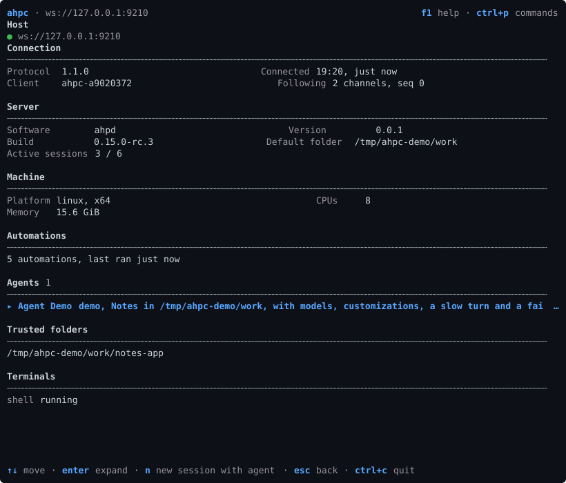

# Host

The host screen shows what the host says about itself. **Show hosts** in the palette opens it.

## Sections

| Section | What it shows |
| --- | --- |
| Connection | The protocol version, when the connection came up, this client's id, the account the host names, the channels followed, and the last host error |
| Server | The host software and its version, the build, the default folder, and the active sessions out of all sessions |
| Machine | The platform, the CPUs and the memory of the host's machine |
| Automations | How many the host keeps, and when one last ran |
| Agents | Each agent, with its provider, description and model count |
| Agent settings | Each agent's settings page and its keys |
| Trusted folders | The folders the host trusts |
| Terminals | Each terminal on the host, and whether it runs |

A section, or a row in it, shows only when the host sent it. VS Code sends no host software, for example, so its *Server* section starts at the build.

## Keys

| Key | |
| --- | --- |
| `up`, `down` | Move through the agents |
| `enter` or a click | Open or close an agent's models |
| `n` | Start a new session with the selected agent |
| `tab` | Move to the page, where `pageup` and `pagedown` scroll it |
| `esc` | Back |
